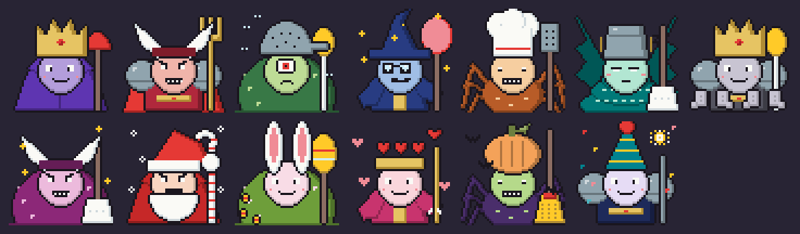

# Weekly Overlords — design

**Goal:** an idea from the project owner (2026-11-08):
1. A different Overlord every week, with enough variety that they still look different after a
   year or more.
2. More bosses, so fights stay entertaining.
3. Holiday bosses, for Christmas, Easter, Valentine's Day and so on, as an opt-in.

**Why:**
- **One Overlord forever:** today the Chore Overlord looks the same every week: a purple robe, a
  gold crown and a plunger staff. Its rhythm already changes with the bosses beaten that week,
  but its look doesn't. After a few weeks the big weekly fight feels like a rerun.
- **Holidays:** a Santa Overlord in Christmas week is a small surprise that makes the app feel
  alive. Not every family celebrates the same days, so holidays are opt-in.

## Decisions (2026-11-08)
| Question | Decision |
|---|---|
| Version | **0.15.0**; the beta moves to 0.16.0. |
| Holidays | **The five below** for now: Christmas, Easter, Valentine's Day, Halloween, New Year. More maybe later. |
| Names | **Generated** names and titles. |
| Traits | **Yes:** each Overlord plays a little differently (section 6). |
| More bosses | **Both** new chore groups and stronger forms, in a design of its own. |

### Later decisions (2026-11-08, in 0.16.0)
| Question | Decision |
|---|---|
| More holidays | **Seven more,** not only Christian ones: Lunar New Year, Diwali, Eid al-Fitr, Hanukkah, Nowruz, Earth Day and the summer solstice. |
| Same Overlord everywhere? | **No: each phone has its own sequence.** A random number made once on the phone shifts where its sequence starts. A MAC address can't be read by apps (and would be personal data). |
| Holiday loot | **A holiday boon for 14 days** after beating a holiday Overlord: a small effect like an item's. |

## Samples
The drawn parts in some of the weekly color schemes (the first is the classic Overlord), then the
five holiday Overlords: Christmas, Easter, Valentine's Day, Halloween and New Year's Eve.

## 1. An Overlord built from parts
Every Overlord is put together from six parts, drawn on the 48×48 boss canvas and stacked:

| Part | First set | Examples |
|---|---|---|
| **Body** | 6 | Robe, armor with pauldrons, slime blob, wizard sleeves, spider legs, serpent coil |
| **Face** | 6 | Grin, angry, cyclops, glasses, sleepy, three eyes |
| **Headgear** | 6 | Crown, horns, wizard hat, bucket, colander, chef's hat |
| **Held item** | 6 | Plunger, mop, toilet brush, spatula, golden fork, feather duster |
| **Extra** | 6 | None, cape, wings, flies, tentacles, sparkles |
| **Color scheme** | 8 | Violet, crimson, moss, midnight, rust, teal, ash, plum |

- **Combinations:** 6 × 6 × 6 × 6 × 6 × 8 = 62,208. At one per week that's about 1,200 years.
- **Household theme:** headgear and items are household things (buckets, colanders, mops), in the
  same spirit as the gear. No text in the art, as always.
- **Silhouettes differ,** not only colors: bodies, headgear and items all change the outline, so
  color is never the only way to tell two Overlords apart.
- **Today's Overlord** (robe, grin, crown, plunger, no extra, violet) is one of the combinations.
  It's the one shown where no week applies, such as in onboarding and the art gallery.

### Drawing order
Back of the extra (cape, wings) → body → held item → head → face → headgear → front of the extra
(flies, tentacles, sparkles).

### Frames
The boss strips have four frames: idle, bob, hit, defeated. For the Overlord:
- **Bob** is the idle picture one pixel lower, done by the app.
- **Hit and defeated** change only the face: each face is a strip of three (idle, hit, defeated).
  When defeated, the headgear also slips two pixels down and to the side.

### Colors
- Parts are drawn with four **key colors**: main, main shade, light (the skin), light shade.
  These are the four `overlord` colors in `bosses.gpl` today.
- A color scheme replaces the key colors, the same way the Wardrobe recolors the hero.
- Fixed colors (outline, white, gold, red, wood, metal …) stay as they are. Each scheme is
  checked for contrast against both the parchment and the dungeon backgrounds.

## 2. Which Overlord in which week
- **Worked out from the week,** like the weekly map (`WeekMap.forWeek`): the same week always
  gives the same Overlord, it changes on Monday, and it needs no network and no storage.
- **Everyone on the phone** meets the same Overlord that week, so they can talk about it.
- **No repeats, and a new look every week:**
  - Every combination has a number from 0 to N − 1 (N = 62,208), read as one digit per part.
  - Week *k* (counted from the epoch Monday, 2024-01-01, which the map uses too) gets
    combination `(a × k + b) mod N`.
  - `a` shares no factor with N, so no combination comes back for N weeks.
  - Every digit of `a` is between 1 and its part's count − 2. So from one week to the next,
    **every part changes**, including after carries.
  - `a` and `b` are picked once and never change, and the digits of `a` are mixed (not all 1),
    so the order doesn't look like counting.
- **Adding parts later:** a bigger N would reshuffle the weeks. So:
  - **The look is stored with each Overlord win,** as a short key like
    `robe.grin.crown.plunger.none.violet`. The Hall of Fame always shows the Overlord as it was.
  - **New parts start at a date:** the week number count restarts with the new N from the week the
    parts arrive. The current week never changes under a player's feet.

## 3. A name for each Overlord
- **Name + title,** chosen from the week like the look, for example:
  - "Grimeclaw of the Sticky Floor" / "Schmierklaue vom klebrigen Boden"
  - "Moldmaw of the Last Sock" / "Schimmelschlund der letzten Socke"
- **Written as pairs,** not translated word by word: each entry is a whole English name with its
  whole German name, both in the game data. German titles are written so they need no gender
  ("vom …", "der …" as a genitive), so any title fits any name.
- **First set:** about 24 names × 24 titles, so a name comes back after about 11 years at the
  earliest. The name list follows its own rule, separate from the look.
- **Where it shows:** fight screen, prep screen, the castle on the map, the result screen, and the
  Hall of Fame. "Chore Overlord" stays as the kind of boss ("Grimeclaw, the Chore Overlord of
  week 46"). Screen readers read the name.
- **The trophy** stays the Crown of the Week.

## 4. Holiday Overlords (opt-in)
- **Setting:** "Holiday Overlords" in Settings, **off by default**, with a check box per holiday.
  It's stored per phone, not per person, because the Overlord is the same for everyone.
- **Which week:** the Monday-to-Sunday week that contains the day:

  | Holiday | Day | Holiday parts |
  |---|---|---|
  | **Christmas** | 24 December | Santa hat, white beard, snowflakes, crimson; name "Tinsel Tyrant" |
  | **Easter** | Easter Sunday (worked out on the phone; it's the last day of its week) | Bunny ears, egg scepter, sparkles, pastel; "Egg-Hoarding Hare" |
  | **Valentine's Day** | 14 February | Heart crown, heart arrow, floating hearts, rose; "Heartbreak Harpy" |
  | **Halloween** | 31 October | Pumpkin head, broom, bats, orange; "Pumpkin Poltergeist" |
  | **New Year** | 31 December | Party hat, sparkler, confetti, midnight; "Count Down" |

  Two holidays never share a week: 24 and 31 December are exactly a week apart, and Easter falls
  between 22 March and 25 April.
- **Still different every year:** a holiday Overlord takes only its holiday parts (headgear,
  item, extra, colors). Its body and face come from that week's normal look. So the Christmas
  Overlord of 2026 and of 2027 aren't the same.
- **A holiday trophy:** beating one also gives a holiday trophy for the Hall of Fame (Christmas
  Star, Golden Egg, Heart Locket, Pumpkin Lantern, Party Popper), in addition to the Crown of the
  Week. Trophies keep the realm's yearly view interesting.
- **Off:** that week has the normal Overlord. Turning it on in the middle of a holiday week changes
  the Overlord only if it hasn't been beaten yet.
- **No surprise religion:** the list is short and every holiday has its own check box, so a family
  picks what fits. More holidays (Carnival, Diwali, Eid, Lunar New Year …) are easy to add as data
  later, but the dates of moon-calendar holidays need tables, so they wait.

## 5. More bosses (later, a design of its own: [more-bosses.md](more-bosses.md))
The eight chore bosses each take their tokens from a group of chores. New bosses fit best where a
group of chores has no boss of its own yet. Ideas for that design, not part of this one:
- **New chore groups:** homework and studying ("Paper Pile Lich"), pets ("Fur Ball Beast"), garden
  (split from "outside": "Weed Wyrm"), cooking and meals (separate from dishes).
- **Stronger forms** of the existing bosses at higher tiers (Dust Bunny King → Dust Bunny Emperor),
  which adds variety without new chore groups.
- The parts system from this design could later be reused for those forms.

## 6. Traits: every Overlord plays a little differently
- **The body sets the trait,** so you can see it: a heavy armored Overlord plays slower, a spider
  skitters faster. The body changes every week, so the trait does too, and a holiday Overlord
  keeps its week's body and trait.
- **Small changes** on top of the borrowed rhythms, never to health or damage:

  | Body | Trait | What changes |
  |---|---|---|
  | Robe | **Classic** | Nothing: today's Overlord |
  | Armor | **Heavy** | 8 BPM slower, one more beat per rhythm |
  | Blob | **Wobbly** | More offbeats (+0.25) |
  | Sleeves | **Spellcaster** | More eighth notes (+0.2) |
  | Spider | **Skittering** | 8 BPM faster |
  | Serpent | **Coiling** | More notes between the beats in the lane phase |

- **Shown before the fight** on the start screen, in a line: "Heavy: slower, but longer rhythms."
- Health, tiers, the lane phase and the curse stay as they are. Slow mode, story mode and the
  difficulty work on top of the trait as usual.

## 7. How it's built
- **Art:** parts as PNGs under `assets/art/bosses/overlord/`: `body_<key>.png`, `face_<key>.png`
  (a strip of three), `hat_<key>.png`, `item_<key>.png`, `extra_<key>.png` (a strip of two: back
  and front). They use the `bosses` palette with the four key colors. A folder rule in `art.json`
  like the hero's `wear` rule, so a new part needs no line there. The art checker makes sure every
  part listed in the game data has its file.
- **Game data:** a new `game/overlords.toml` with the part keys in order (append only, because
  keys are stored), the color schemes, the name and title pairs, the holidays, and the date at
  which each set of parts starts. `tool/build_game_data.py` turns it into code and texts as usual.
- **Code:**
  - `domain/fight/overlord_look.dart`: the week → look and name rule, holidays and the Easter date.
  - `OverlordArt`: stacks and recolors the parts, used in place of `BossArt` for the Overlord.
  - The look key is stored with the Overlord's win: a new column, schema v11, with a migration;
    older wins get today's Overlord.
- **Settings:** the holiday switch and its check boxes, in both ARB files.

## Tests
- **Rule:** the same week gives the same look; 62,208 weeks in a row have no repeat; every part
  changes from one week to the next; a new parts set starts at its date without changing earlier
  weeks.
- **Names:** same rule, and every name and title exists in English and German.
- **Holidays:** Easter dates against a table (2024–2040), each holiday's week, Christmas and New
  Year in one week, the opt-in off and per holiday, turning it on mid-week after a win.
- **Storage:** the look is stored with the win and shown in the Hall of Fame; the migration gives
  older wins today's Overlord.
- **Art:** every part exists and uses only palette colors; every scheme passes the contrast check
  on day and night.
- **Emulator:** the Overlord on the map, prep, fight (hit, defeated) and Hall of Fame, a holiday
  week (set by the clock), day and night themes, German at 200 %, TalkBack reading the name.

## As built (changes to the plan)
- **Six bodies,** not four: spider legs and a serpent coil were added, so each of the six traits
  has its own body. 62,208 combinations.
- **The step between weeks** is searched by the app from about 0.38 × N (`weekStep` in
  `lib/domain/fight/overlord.dart`), so `game/overlords.toml` holds only the lists and the eras.
  The first week of the first era (2024-01-01) is the classic Overlord.
- **Faces draw the head too,** so a face can shape it. Each face is a strip of three: idle, hit
  (crossed eyes, open mouth) and defeated (crossed eyes, wobbly mouth).
- **Holiday parts** live in the same folders as the weekly ones, but only holidays use them. A
  stored look with a holiday part and no holiday counts as unknown and shows the classic Overlord.
- **The setting** is one switch (off by default) that turns all five holidays on, with a check box
  per holiday below it. Unchecking the last one turns the switch off.
- **Stored look:** `fights.look` holds `body.face.hat.item.extra.scheme.name.title.holiday`.
  It's written when the fight starts, also in story mode, and read for the Arena card (once beaten
  this week), the trophy shelf and the realm.
- **Holiday trophies** are listed after the boss trophies, each with the classic Overlord in its
  holiday parts.
- **The realm** shows the beaten Overlord above its castle in the detailed (month) view.
- **No two holidays share a week** (checked for 50 years in the tests), so there is no rule for
  overlaps.

## In 0.16.0
- **Twelve holidays.** Days are `MM-DD`, Easter (worked out), Hanukkah's first day (worked out from
  the Hebrew calendar) or a table of dates for the ones that follow the moon: Lunar New Year and
  Eid al-Fitr until 2040, Diwali until 2036. The tables need extending before they run out; a
  holiday past its table simply doesn't appear. Eid depends on the moon sighting and can be a day
  off locally.
- **Shared weeks:** holidays can now fall in the same week (Hanukkah and Christmas in 2024 and
  2027, Diwali and Halloween, Eid and Nowruz …). If more than one is turned on, they take turns by
  year, in the order of `game/overlords.toml`.
- **Respectful parts:** the Overlord is a villain, so the religious holidays get festive, not sacred,
  things: a lion-dance head and lanterns, marigolds and a firework rocket, a star garland and a
  lantern, a dreidel and a bag of chocolate coins. Their villains snatch treats (Sweets Snatcher,
  Maamoul Muncher, Gelt Gobbler); Lunar New Year's is the Nian beast of the legend.
- **Per-phone sequence:** `overlordSeed` in the settings, made with `Random.secure` on first start
  and kept (also in backups). `OverlordLook.forWeek(seed:)` uses `(step × week + seed) mod N`, so
  the no-repeat and every-part-changes rules hold for every phone. Phones that update get their
  number on the first start: an Overlord not beaten yet this week may change once.
- **Boons:** each holiday has `boon` effects in `game/overlords.toml` and `[boons] days = 14`. They
  come from the stored holiday wins (no new data), work for the person who won, add up with the
  gear (`Loadout.boon`), and show on the fight's start screen with the days left and on the
  result screen.

## Version
**0.15.0**, decided 2026-11-08. The beta moves to 0.16.0.
